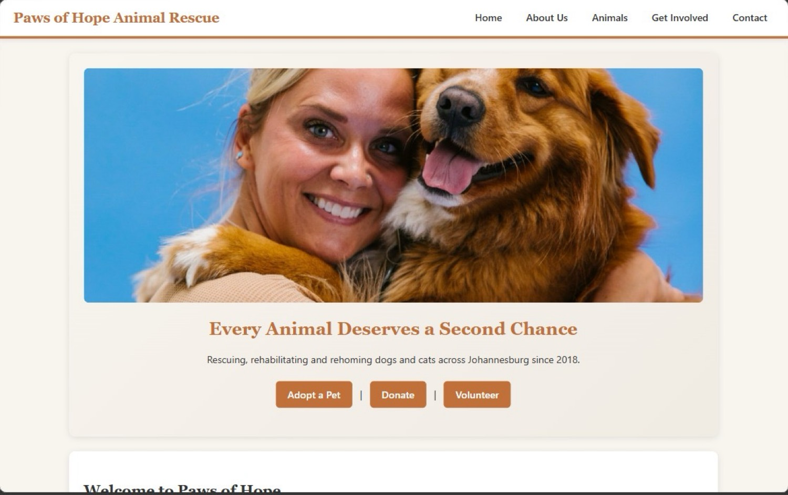
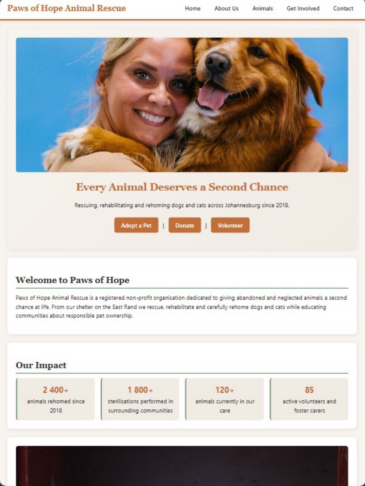
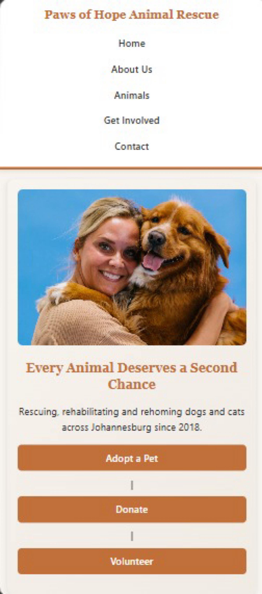

# Paws of Hope Animal Rescue

**Student:** Dipolelo Pretty Dikgake  
**Student number:** ST10501461  
**Group:** 01  
**Module:** WEDE5020 – Web Development  

---

## About the project

This is the website for Paws of Hope Animal Rescue, a non-profit animal rescue based in Johannesburg. The site helps people adopt animals, volunteer, donate and learn more about the organisation.

---

## Goals

- Help more animals find homes
- Make it easy for people to donate and volunteer
- Share information about the rescue and responsible pet ownership

---

## Pages

- **Home** – introduction and impact stats  
- **About Us** – history, mission and team  
- **Animals** – animals available for adoption (with search)  
- **Get Involved** – forms for adoption, volunteering and donations  
- **Contact** – contact details, map and contact form  

---

## Features

**HTML & structure**  
Five pages with navigation, semantic HTML and organised folders.

**CSS**  
External stylesheet with the project colour scheme (terracotta, sage green, cream). Layout uses Flexbox and Grid. The site is responsive for desktop, tablet and mobile.

**JavaScript**  
- Click images to open a larger view (lightbox)  
- Search box on the Animals page to filter animals  
- Accordion for the adoption steps  
- Form validation on the enquiry and contact forms (shows errors if fields are empty or invalid, and a success message when submitted correctly)  

**SEO**  
Each page has its own title and meta description. Images have alt text. robots.txt and sitemap.xml are included.

**Map**  
An OpenStreetMap embed is on the Contact page showing the Benoni area.

---

## Folder structure

```
paws-of-hope/
├── index.html
├── about.html
├── animals.html
├── enquiry.html
├── contact.html
├── robots.txt
├── sitemap.xml
├── css/styles.css
├── js/main.js
├── images/
├── screenshots/
└── README.md
```

---

## Responsive screenshots

### Desktop


### Tablet


### Mobile


---

## How to view the site

Open `index.html` in a browser.  
For mobile/tablet testing: press F12 → device toolbar → choose a device size.

---

## Deployment

The site can be published on GitHub Pages or Netlify.  
After publishing, update the URLs in `robots.txt` and `sitemap.xml` to match the live link.

---

## Changelog

**Part 1**  
- Created the five HTML pages and folder structure  
- Added content and images  

**Part 2**  
- Added full CSS styling and responsive design  
- Added screenshots of different screen sizes  

**Part 3**  
- Added JavaScript (lightbox, search, accordion, form validation)  
- Added SEO meta tags on all pages  
- Added robots.txt and sitemap.xml  
- Added map on the Contact page  

---

## References

- Website Project Proposal for Paws of Hope Animal Rescue  
- Pexels – free stock photos (https://www.pexels.com)  
- OpenStreetMap (https://www.openstreetmap.org)  
- WEDE5020 assignment brief (Parts 1–3)  
- MDN Web Docs  
